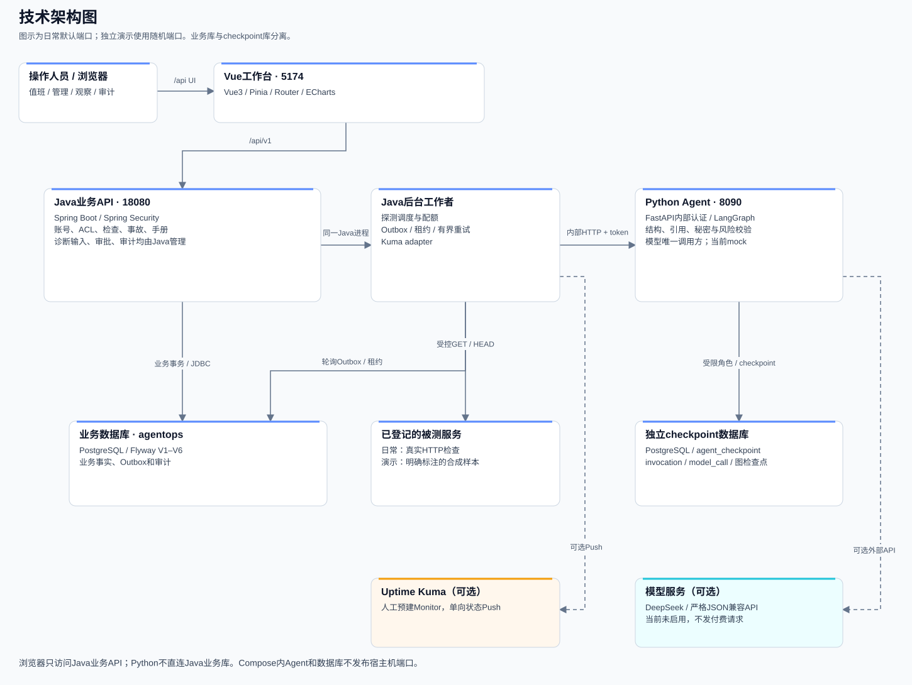

# Dawnwatch

Dawnwatch 是一个面向值班团队的运维协作平台。从服务健康检查和事件聚合，到 AI 证据诊断、人工审阅和结果回填，处理过程可在同一工作台中追溯。

## 主要功能

| 功能 | 说明 |
| --- | --- |
| 服务监控 | 登记服务和 HTTP 健康检查，查看检查历史、延迟和最新健康状态。 |
| 事件处理 | 按连续失败阈值生成事故，记录确认、排查、恢复观察、解决和关闭。 |
| AI 故障诊断 | 从冻结的检查和已发布的运行手册生成诊断报告，区分观测、推断和未知，并附上可核对的引用。 |
| 人工审阅 | 由授权值班人员批准或拒绝建议，线下处理后回填结果。平台中的诊断工具只有读取权限。 |
| 运维知识库 | 编辑和发布版本化运行手册，旧诊断继续引用当时的版本。 |
| 模型配置与用量 | 管理员可加密保存 DeepSeek Key、测试连接、查看余额和 Token 趋势，并追踪请求来自哪个业务环节。 |
| 诊断质量中心 | 离线查看合成评测场景及报告，核对证据并通过 JSON 导入、导出人工评分。 |

Uptime Kuma 是可选集成。Dawnwatch 通过 Push 将健康状态发送到已配置的 Kuma Monitor。

## 快速体验

Windows 本机演示需要 Git、Java 21、Maven 3.9、Python 3.13 和 Node.js 22.12 或更高版本。将 `JAVA_HOME` 指向 Java 21，并确保 Maven、Python 和 Node.js 在 `PATH` 中。首次安装需要访问依赖仓库。

在 PowerShell 中执行以下命令。如果从其他分支阅读本页，请在安装前切换到对应分支。

```powershell
git clone https://github.com/kevin-sanas/Dawnwatch.git
Set-Location Dawnwatch
.\scripts\agent.ps1 Install -Dev
npm --prefix frontend ci --ignore-scripts --no-fund --no-audit
.\scripts\demo.ps1
```

打开终端打印的网址，使用同一终端显示的临时账号和密码登录。演示自带服务、检查和运行手册，使用独立的临时 PostgreSQL 和 mock 诊断，无需填写 DeepSeek Key。

1. 在演示终端输入 `down`，然后在「告警与事件」中打开新事故。
2. 确认事故、开始排查并发起 AI 诊断，核对证据并处理人工审阅。
3. 在终端输入 `up`，核对恢复过程并关闭事故。验收结束后输入 `quit`。

日常 IDEA 启动、数据库配置、DeepSeek 页面配置和故障排查见 [IDEA 启动与验收指南](IDEA启动与验收指南.md)。也可以使用 Docker Compose，容器间的 Agent HTTPS 证书由部署自动生成。[Compose 部署说明](docs/12-本地部署运维与CI-CD.md)

## 架构与目录



Vue 工作台通过同源 API 访问 Spring Boot 后端。Java 管理用户权限、监控、事故和审计，通过 Outbox 将诊断任务交给 Python Agent。Agent 使用 FastAPI 和 LangGraph，由独立 PostgreSQL 保存诊断检查点。Flyway 管理业务库迁移。

| 目录 | 用途 |
| --- | --- |
| [`frontend/`](frontend/) | Vue 3、TypeScript、Vite 和 ECharts 工作台 |
| [`backend/`](backend/) | Java 21、Spring Boot 业务 API 与后台调度 |
| [`agent-service/`](agent-service/) | FastAPI、LangGraph、模型适配和离线评测 |
| [`db/migration/`](db/migration/) | PostgreSQL 业务库的 Flyway 迁移 |
| [`scripts/`](scripts/) | 本机启动、开发验证、演示和隔离恢复工具 |
| [`docs/`](docs/) | 设计说明、架构、数据模型与接口契约 |

功能结构、技术架构、数据库设计和系统流程图见[项目详细说明](项目详细说明.md)，四张图也可以在[离线图文版](docs/project-overview/项目详细说明.html)中查看。公共接口见 [API 契约](docs/07-API契约.md)。

## 开发与测试

先按快速体验一节安装依赖，再在项目根目录运行以下检查。

```powershell
.\scripts\agent.ps1 Test
.\scripts\backend.ps1 verify
npm --prefix frontend test
npm --prefix frontend run build
```

前端测试建议使用 Node.js 24。运行 `.\scripts\demo.ps1 -Check` 可验证隔离演示。完整验证入口和覆盖范围见[测试指南](docs/13-测试矩阵与阶段门.md)，CI 定义见 [GitHub Actions 工作流](.github/workflows/backend.yml)。

## 反馈与贡献

反馈问题时，请注明版本、运行环境、复现步骤和脱敏后的错误信息。提交 Pull Request 时，请说明变更范围和验证方式。请从反馈与提交中移除 API Key、密码、会话令牌、真实业务证据和本机配置。[GitHub Issues](https://github.com/kevin-sanas/Dawnwatch/issues) · [安全与权限说明](docs/09-安全隐私与权限.md)

## 许可证

Dawnwatch 的原创源码和文档采用 [MIT 许可证](LICENSE)。第三方组件依各自的许可条款分发，参见 [Python 依赖声明](agent-service/THIRD_PARTY_NOTICES.txt)、[前端依赖声明](frontend/public/THIRD_PARTY_NOTICES.txt)和[上游许可与接口说明](docs/15-开源许可证与接口核验.md)。
