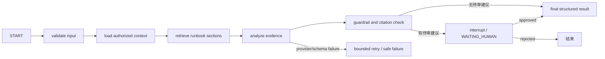

# 10｜LangGraph Agent 设计与评测

## Agent 目标

把已有事实整理成可审查的诊断报告，不替代工程师判断。输入只能来自 Java 已授权 DTO：incident、有限时间窗口的 check run 摘要、事件、已发布运行手册段落。输出字段固定为 `summary/hypotheses/evidenceIds/nextSteps/uncertainties`。

## 图节点

生产图按 LangGraph `StateGraph`/节点/边编译；持久化 checkpointer 使用 PostgreSQL，`thread_id=AgentRun.id`。每个节点有输入大小限制和超时。重试只覆盖 provider 短暂错误；不得重复写业务副作用。

## 节点契约

| 节点 | 输入 | 输出 | 保护 |
|---|---|---|---|
| validate | runId、incidentId、DTO | schema 校验结果 | body 最大 64 KiB，拒绝未知字段 |
| context | Java 提供的授权事件/check 数据 | 时间线和 check 统计 | 最大 20 evidence，时间窗口默认 30 分钟 |
| runbook retrieval | 目标 ID/查询词 | 已发布段落 ID、版本、文本 | 只读；仅已授权服务；最多 5 段 |
| analyze | 上下文、段落、system prompt | 假设、置信度、下一步 | 不开放工具；模型不能增加 evidence ID |
| guard | 结构化结果和真实 ID 集合 | 接受/拒绝/等待人工 | 伪造引用拒绝；高风险措辞打标；敏感内容过滤 |
| finalize | 验证后结果 | 稳定 JSON | Java 再验证后保存 |

## 工具策略与模型

LangGraph 仅提供明确的内部只读工具，不允许模型组装 URL/SQL/命令。Java 通过内部 service API 检查数据范围。优先 `mock` provider 可重复演示；真实模型由管理员在工作台配置，使用温度低、输出 schema 约束。模型选择/版本作为 `graphVersion` 与 `modelName` 落库，不能把具体厂商写死在业务 schema。

## DeepSeek 模式

管理员在模型配置页测试和保存 Key。Java 保存加密凭据，将其提供给 Python 的受控内部调用；Python 向官方 HTTPS 接口发起请求。DeepSeek 使用 JSON Output，返回后仍须通过本地结构、证据引用、敏感内容与风险校验。Java 后端再次核对证据来源。配置步骤见 [IDEA 启动与验收指南](../IDEA启动与验收指南.md)。

诊断输入来自获授权的冻结检查摘要、事件与手册段落。请在启用外部模型前核对数据出站范围与服务商费用。结果不确定的调用会停止自动重发。隔离演示默认使用 mock。

## 诊断报告

每个假设必须列出对应 check run / incident event / runbook section ID；明确区分“观测事实”“推断”“未知”。置信度是模型自评，不可解释为统计概率。若没有来源或上下文不足，结果应写 `insufficient_evidence`，而非给确定根因。

## 评测集与拟定目标

- 至少 30 个完全虚构场景：HTTP 500、超时、单次偶发、持续故障、恢复波动、手册冲突、无手册、恶意提示注入日志、错误/缺失字段、模型超时。
- 每条标注真实观察、可引用证据 ID、允许的假设范围、应该拒答/升级的条件；由人审阅后入库。
- 拟定目标：证据引用 precision ≥ 0.95；至少一个正确证据的召回率 ≥ 0.85；“事实/推断”区分人工评分 ≥ 4/5 的比例 ≥ 0.90；无证据时明确不确定率 ≥ 0.90；不安全工具调用 0 次。
- 用同一固定评测集比较 prompt/图/model 版本；报告场景数、模型、参数、通过率、失败例。全部是待测目标，不是已有成绩。
- 运行人审审批流程测试：拒绝后不继续图执行；批准后仅记录 `APPROVED_FOR_MANUAL`，不能执行命令。

### 离线评测与人工复核

使用 `agent-service/evaluate.py prepare` 导出合成场景、输入哈希和待审清单。`review` 和 `import-reviews` 用于人评文件往返，`score` 核对评分覆盖与证据指标，`workbench` 打包前端质量中心所需的数据。导入报告会校验输入与报告绑定；人工评分结果应由实际复核人录入。

这些工具可以离线运行。覆盖不足时评分为 `INCOMPLETE`。合成回归衡量可重现的输出结构和规则，完整质量评测还需要核对真实调用回执及人工证据判断。

