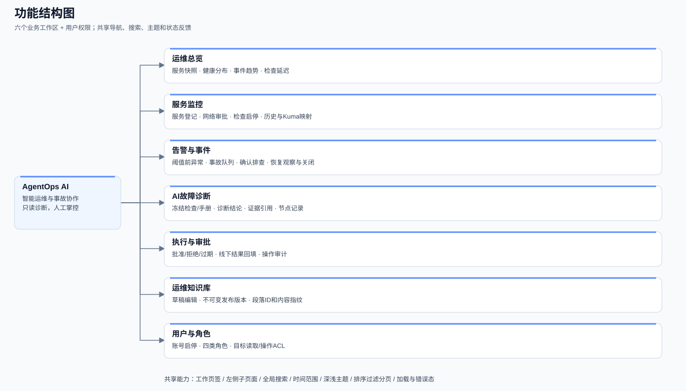
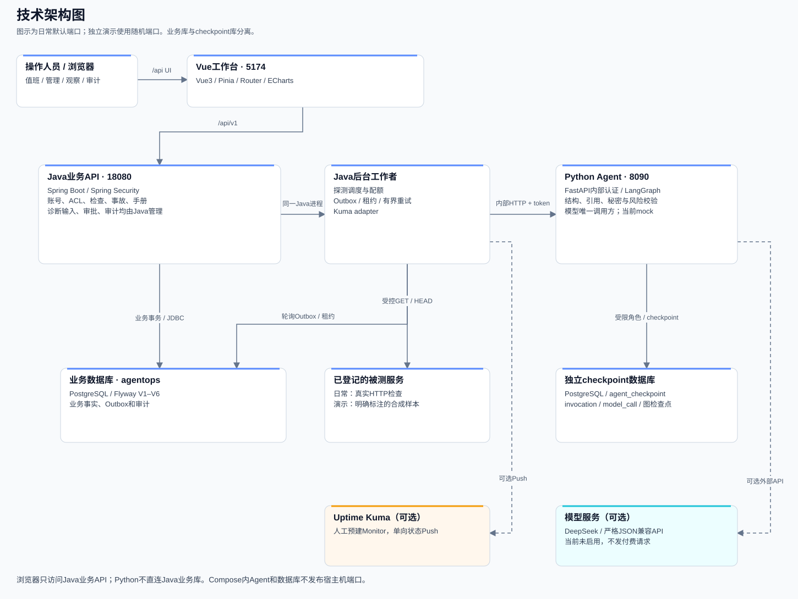
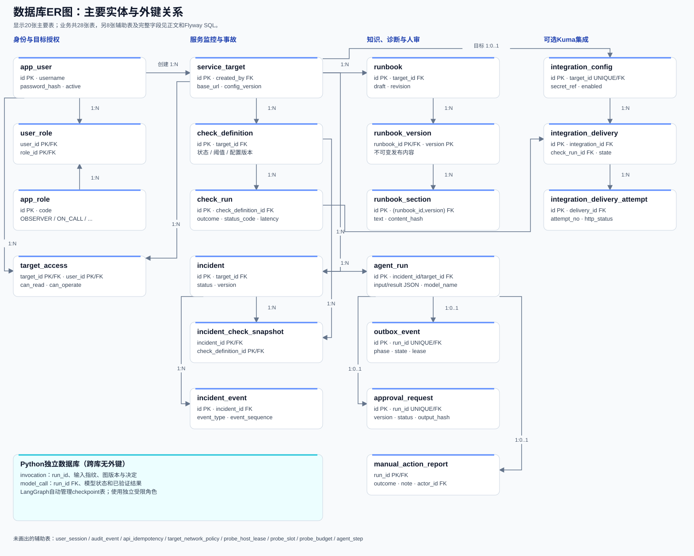
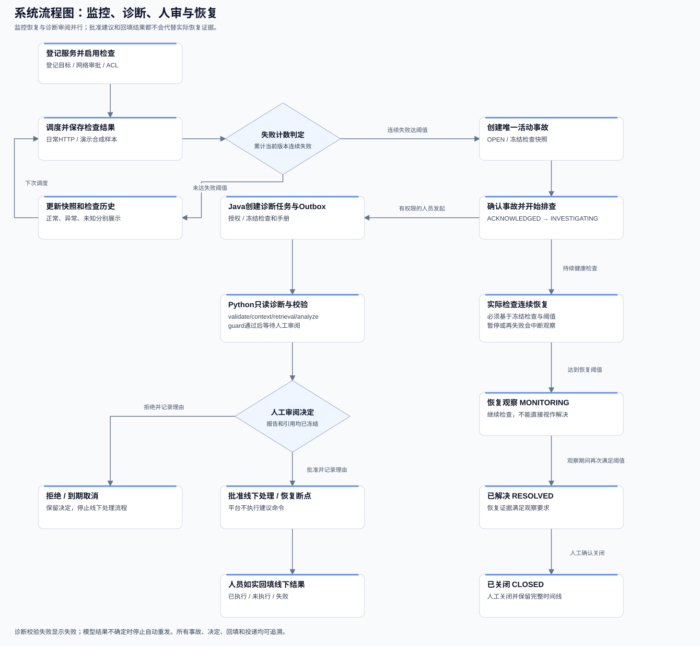

# Dawnwatch 项目详细说明

Dawnwatch 将服务监控、事故处置、证据诊断与人工审阅组织为一条可追溯的运维流程。

## 功能结构

| 模块 | 职责 |
| --- | --- |
| 运维总览与服务监控 | 展示检查、探测延迟和健康状态。值班人员可以从异常服务进入相关事故。 |
| 告警与事件 | 记录连续失败达到阈值、人工确认、排查、恢复观察、解决和关闭。 |
| AI 故障诊断 | Java 生成证据快照，Python Agent 整理观测及手册，返回含引用的结构化诊断。 |
| 执行与审批 | 被授权的值班人员审核建议，在线下处理后回填结果。 |
| 运维知识库 | 管理手册草稿和不可变的发布版本，供后续诊断引用。 |
| 系统管理 | 管理用户、角色、目标访问权限及模型配置。 |

## 技术架构

Vue 工作台访问 Spring Boot 的同源 API。Java 持有权限与业务状态，通过 Outbox 将诊断任务发给 Python。FastAPI 提供内部接口，LangGraph 执行诊断图并将检查点持久化到独立 PostgreSQL。模型默认使用 mock，管理员可在页面启用 DeepSeek 并查看用量和调用来源。Uptime Kuma 可接收健康状态推送。

## 数据库设计

图展示业务核心实体。会话、审计、模型配置和用量等附属结构以 [Flyway 迁移](db/migration/)为准。业务库保存服务、检查、事故、手册及审阅状态。Python 在独立 checkpoint 库保存图执行状态与模型调用结果，通过 `runId` 与业务诊断对应。完整设计见[数据模型](docs/06-数据模型ERD与SQL.md)。

## 系统流程

1. 启用服务检查后，监控任务按配置执行，连续失败达到阈值时创建事故。
2. 值班人员确认并排查事故。启动诊断时冻结检查证据和相关手册版本。
3. Agent 生成带引用的建议，校验通过后提交人工审阅。被批准的建议由值班人员线下处理并回填。
4. 检查重新满足恢复阈值后，值班人员核对观察结果并关闭事故。

[IDEA 启动与验收指南](IDEA启动与验收指南.md) · [架构说明](docs/05-架构与技术选型.md) · [API 契约](docs/07-API契约.md) · [安全与权限](docs/09-安全隐私与权限.md)
